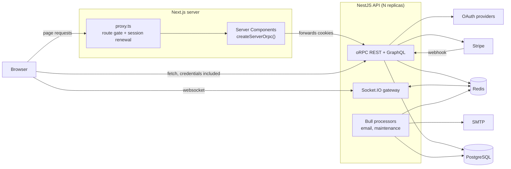
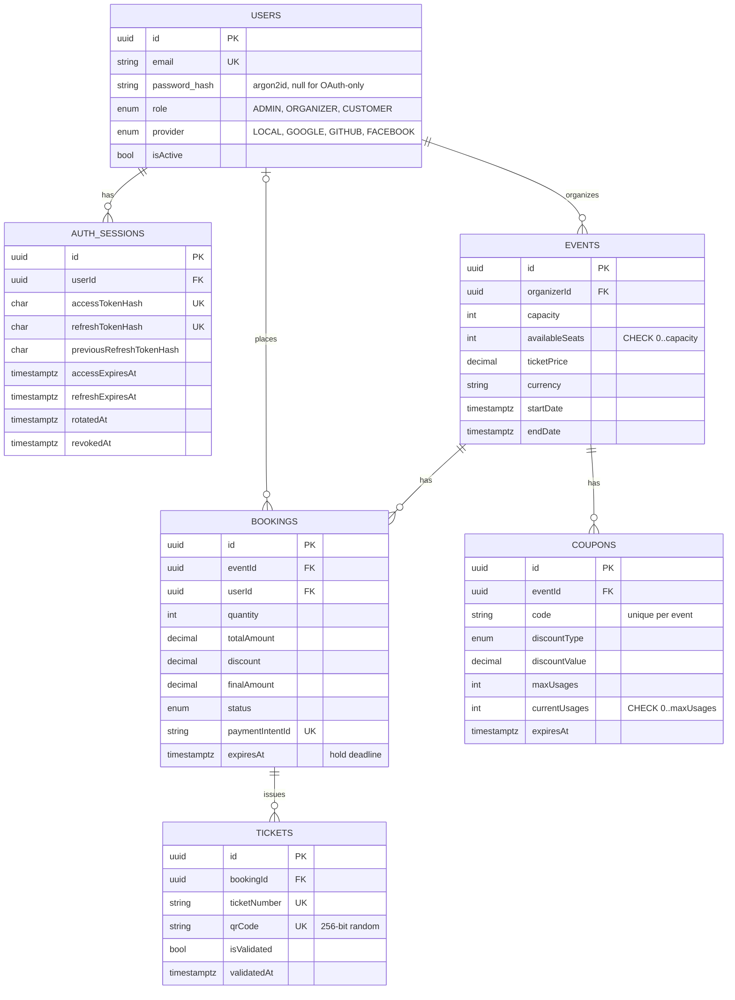
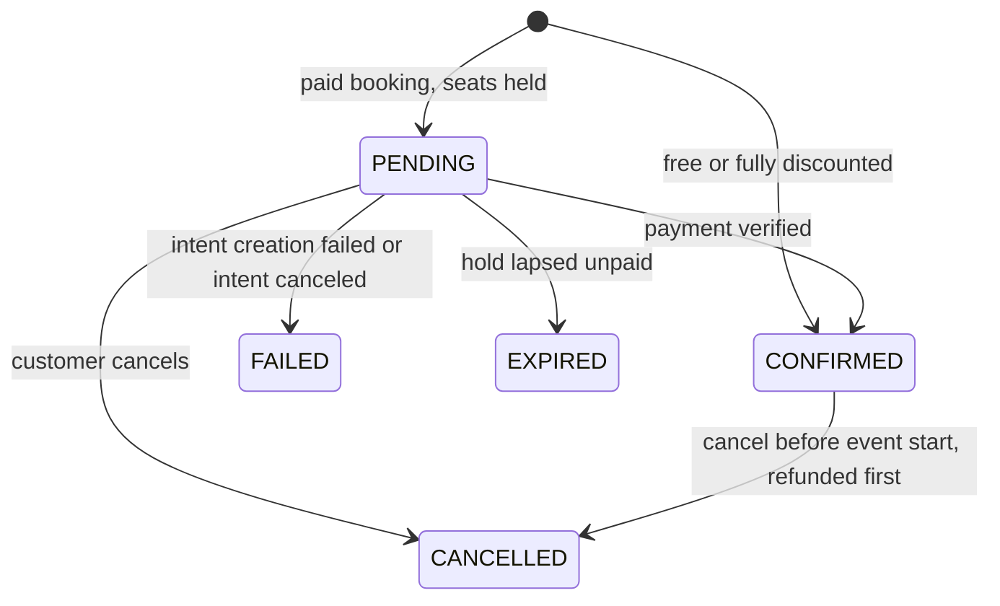
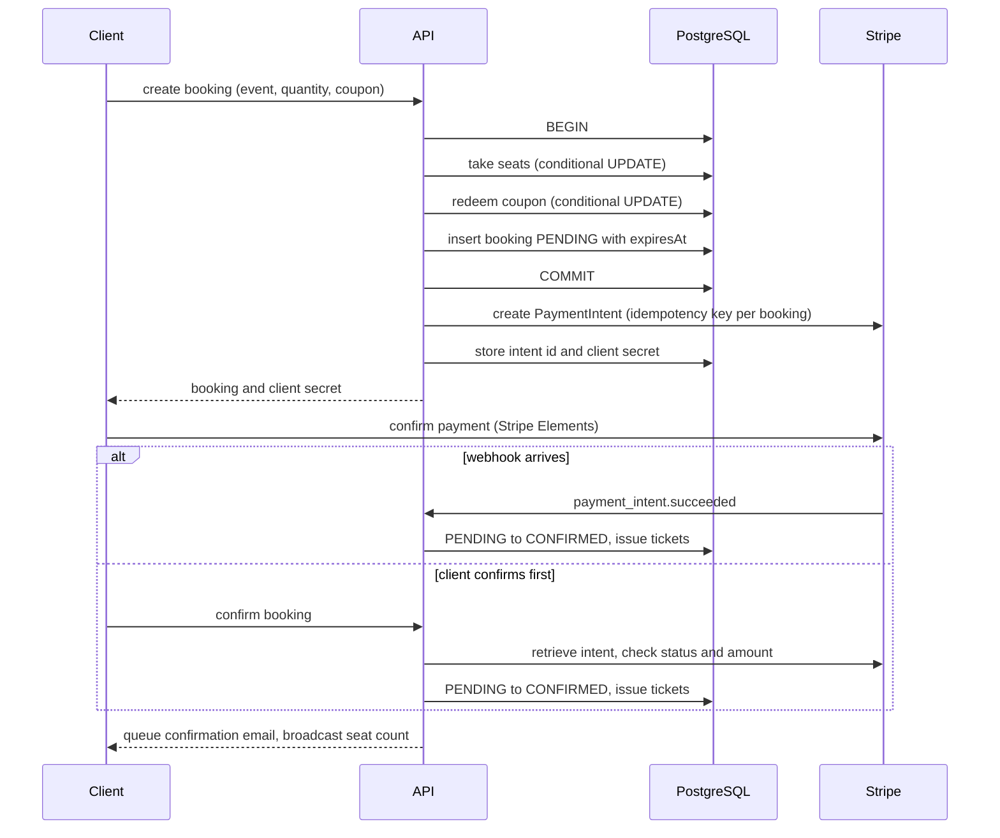

# Architecture

How Eventeer is put together and why. For setup and commands see the [README](readme.md); for the AWS deployment design see [`aws_architecture_doc.md`](aws_architecture_doc.md).

## Contents

- [Overview](#overview)
- [Decisions](#decisions)
- [Repository and dependency rules](#repository-and-dependency-rules)
- [Backend](#backend)
- [Data model](#data-model)
- [Booking and payment flow](#booking-and-payment-flow)
- [Authentication and sessions](#authentication-and-sessions)
- [Real-time and background work](#real-time-and-background-work)
- [Frontend](#frontend)
- [Failure modes](#failure-modes)
- [Observability](#observability)
- [Testing](#testing)
- [Deployment](#deployment)
- [Known limitations](#known-limitations)

---

## Overview

A modular monolith: one NestJS API (stateless, horizontally scalable) and one Next.js server, sharing a Zod/oRPC contract. State lives in PostgreSQL; Redis holds only derived or transient state (session lookup cache, Bull queues, Socket.IO fan-out), so losing Redis degrades features but never loses booking or user data.



The browser talks to the API directly for interactive calls and to the Next.js server for pages. Both paths must be **same-site and, in deployment, same-origin** (see [Deployment](#deployment)), because authentication is `httpOnly` cookies that the Next.js server also needs to read.

---

## Decisions

| Decision                     | Choice                                                                                   | Why                                                                                                                                                   | Cost                                                                                           |
| :--------------------------- | :--------------------------------------------------------------------------------------- | :---------------------------------------------------------------------------------------------------------------------------------------------------- | :--------------------------------------------------------------------------------------------- |
| System boundary              | Modular monolith                                                                         | One deployable, in-process calls inside a booking transaction, no distributed transactions. Module boundaries are explicit (see [Backend](#backend)). | Workers run inside API processes, so they scale together.                                      |
| API typing                   | oRPC contract package shared by both apps                                                | One definition feeds server implementation, client types, form validation and the OpenAPI document.                                                   | oRPC 2 is a beta dependency.                                                                   |
| Sessions                     | Opaque random tokens in Postgres, hashed, cookie-only                                    | Immediate revocation, rotation with replay detection, no secrets to sign with, nothing readable from JS.                                              | A lookup per request; mitigated by a 30 s Redis cache.                                         |
| Seat and coupon accounting   | Single conditional `UPDATE ... RETURNING` in the booking transaction                     | Correct under concurrency without holding explicit locks or adding Redis locks; rolls back atomically with the booking.                               | All buyers of one event serialise on that event's row (see [limitations](#known-limitations)). |
| Payment confirmation         | Webhook and client confirm converge on one idempotent transition                         | Webhooks can be late, duplicated or lost; the customer should not wait on one.                                                                        | Two entry points to keep consistent (both call `finalizePaid`).                                |
| Unpaid bookings              | `PENDING` hold with a deadline, swept by a job                                           | Seats are not leaked by abandoned checkouts or crashes between steps.                                                                                 | Up to one sweep interval of slack after the deadline.                                          |
| Payments when Stripe is down | Fail closed                                                                              | A fallback to mock payments would issue free tickets.                                                                                                 | Bookings fail during an outage.                                                                |
| Background jobs              | Bull on Redis                                                                            | Already running Redis; retries, backoff and repeatable jobs are built in.                                                                             | Jobs live in Redis; not a durable log.                                                         |
| Schema management            | TypeORM migrations, `synchronize: false`                                                 | Reviewable, repeatable. Production runs them as a separate step so replicas do not race.                                                              | Migrations are written and reviewed by hand.                                                   |
| Frontend delivery            | Next.js server (not a static SPA)                                                        | Server Components render authenticated pages without a client waterfall; `proxy.ts` can renew sessions before render.                                 | Needs a Node runtime; CDN-only hosting is not an option.                                       |
| REST vs GraphQL              | oRPC (REST) is the main surface; GraphQL is a thin second surface over the same services | Business rules live in services, so both surfaces cannot drift.                                                                                       | Two transports to keep tested.                                                                 |

### Why not `SELECT ... FOR UPDATE` or Redis locks

Seats are taken with one statement:

```sql
UPDATE events
SET "availableSeats" = "availableSeats" - :qty
WHERE id = :id AND "availableSeats" >= :qty AND "endDate" > now()
RETURNING ...
```

Postgres takes the row lock for the duration of that statement only. Concurrent buyers queue on the lock, re-evaluate the `WHERE` clause after it is released, and the losers see zero rows and get a precise error ("sold out", "only N left", "event ended"). Compared with `SELECT ... FOR UPDATE` it holds the lock for one statement instead of a read-compute-write span, and it cannot forget to lock. Compared with a Redis lock it adds no infrastructure, has no lease-expiry edge cases, and participates in the same transaction as the booking insert and coupon redemption. `CHECK ("availableSeats" >= 0 AND "availableSeats" <= "capacity")` makes overselling impossible even if a code path regresses. Coupons use the same pattern (`currentUsages < maxUsages`).

---

## Repository and dependency rules

```
apps/backend          @eventeer/api    -> contract, shared-schemas
apps/frontend         @eventeer/web    -> contract, shared-schemas
packages/contract     @packages/contract         -> shared-schemas
packages/shared-schemas  @packages/shared-schemas   (no internal dependencies)
```

Dependencies point one way: `shared-schemas <- contract <- apps`. Turborepo builds in that order and typechecks every app against the freshly built packages, so a contract change that breaks either side fails the same CI run.

`dependency-cruiser` (`yarn lint:deps`, run in CI) enforces:

- no circular imports (entity files are exempt, because TypeORM relations are inherently bidirectional);
- `shared-schemas` must not import from `apps/`;
- `apps/frontend` must not import from `apps/backend`.

Both packages are built to `dist/`, so the CommonJS-compiled API and the Next.js app (via `transpilePackages`) consume the same artefacts. `shared-schemas` also holds the cookie names and cookie option defaults shared by both sides.

---

## Backend

### Modules

| Module              | Responsibility                                                                                          |
| :------------------ | :------------------------------------------------------------------------------------------------------ |
| `auth`              | Session service, local and OAuth login, authentication / origin / roles guards                          |
| `events`            | Event CRUD, filtering and pagination, seat primitives (`reserveSeats`, `releaseSeats`), seat broadcasts |
| `bookings`          | Booking lifecycle, Stripe webhook controller, GraphQL resolver                                          |
| `coupons`           | Coupon CRUD, `redeem` / `release` (always called inside the booking transaction)                        |
| `payment`           | Stripe adapter (plus a dev-only mock), under the `stripe` resilience preset. No dependency on booking code           |
| `tickets`           | Check-in validation and QR lookup                                                                       |
| `email`             | Queueing, templates, SMTP delivery                                                                      |
| `websocket`         | Socket.IO gateway and Redis adapter                                                                     |
| `maintenance`       | Repeatable jobs: hold expiry, session purge                                                             |
| `health`, `graphql` | Health endpoints, GraphQL wiring                                                                        |
| `common`            | Idempotency store, resilience logging, money helpers, pagination, exception filter, middleware                                |

`bookings` depends on `events`, `coupons`, `payment` and `email`. The webhook controller lives in `bookings` rather than `payment` so that `payment` stays a leaf.

### Request pipeline

1. Express level: Helmet, CORS (single allowed origin, credentials), cookie parser. Nest's body parser is off because oRPC consumes the request stream itself; the Stripe webhook route gets a raw `Buffer` (signature verification needs the exact bytes) and `/graphql` gets a JSON parser.
2. Global guards, in order: **throttler -> origin check -> authentication -> roles**. Authentication is default-deny; `@Public()` routes still populate `request.user` when a valid cookie is present.
3. oRPC middleware: correlation ID -> current user -> role check -> handler. Controllers are thin transport; ownership and business rules live in services (for example, other users' bookings return 404 rather than 403, so ids cannot be probed).
4. Errors: services throw Nest exceptions, translated to oRPC errors by an interceptor; anything else is normalised by a global filter to `{ defined, code, message }`. Internal details are never returned in production.

### Access model

| Area     | Public                      | Authenticated                         | Organizer (own events) / Admin              |
| :------- | :-------------------------- | :------------------------------------ | :------------------------------------------ |
| Events   | list, detail                | n/a                                   | create, update, delete                      |
| Bookings | n/a                         | create, confirm, view own, cancel own | bookings of own events; Admin: all bookings |
| Coupons  | look up a code for an event | n/a                                   | create, list, activate/deactivate           |
| Tickets  | look up by QR               | n/a                                   | validate (check-in)                         |

Rate limits (per IP): 120 req/min globally; 10/min on register, login, email verification, password reset and booking creation; 5/min on forgot-password; 30/min on refresh.

---

## Data model



Constraints and indexes that carry correctness, not just speed:

- `events`: `CHECK (availableSeats BETWEEN 0 AND capacity)`; indexes on `startDate` and `organizerId`. `bookings.eventId` is `ON DELETE RESTRICT`, so sales history cannot be deleted with its event (the API turns the FK error into a 409).
- `coupons`: unique `(code, eventId)`; `CHECK (currentUsages BETWEEN 0 AND maxUsages)`.
- `bookings`: partial unique index on `paymentIntentId` (where not null), so one payment maps to at most one booking; index on `(status, expiresAt)` serves the hold-expiry sweep.
- `tickets`: unique `ticketNumber` and `qrCode`.
- `users`: unique lower-cased `email`; partial unique `(provider, providerId)`; email-verification and password-reset tokens are stored as SHA-256 hashes.
- `auth_sessions`: unique `accessTokenHash` and `refreshTokenHash` (single-index-hit lookups), index on `previousRefreshTokenHash` (replay detection) and `(userId, revokedAt)`.

Money is `numeric(10,2)` in storage and integer cents in all arithmetic. Queries run with a 10 s `statement_timeout`.

### Booking states



Every transition out of `PENDING` is a conditional `UPDATE ... WHERE status = ...`. Whichever path (webhook, client confirm, expiry job, cancel) updates the row first wins; the others see zero affected rows and do nothing. Leaving an active state also returns the seats and the coupon usage in the same transaction.

---

## Booking and payment flow



Properties worth knowing:

- **Pricing is server-side.** The client sends event, quantity and a coupon code, never an amount. Discounts are computed from the real ticket price and capped at the total.
- **No external call inside the transaction.** If creating the intent fails after commit, `release()` moves the booking to `FAILED` and returns seats and coupon usage.
- **Free bookings skip payment.** A 100 % coupon or a free event confirms immediately and issues tickets in the same transaction.
- **Tickets exist only after confirmation.** The Stripe client secret is returned only to the owning customer while the booking is `PENDING`.
- **Cancellation order matters.** For a confirmed booking the refund is issued first; if it fails, nothing is released and the booking stays `CONFIRMED`. A pending booking cancels its payment intent instead.
- **Late payments are refunded.** A success webhook for a booking that is already expired, failed or cancelled triggers a refund.
- **The expiry job is payment-aware.** For each lapsed hold it asks Stripe: `succeeded` confirms the booking, `processing` is left for the next run, anything else cancels the intent and releases the seats. A booking that never got an intent (process died between commit and intent creation) is simply released.
- **Webhook events handled:** `payment_intent.succeeded` and `payment_intent.canceled`. `payment_failed` is ignored on purpose: a declined card leaves the intent retryable, so the hold stays valid until it expires.
- **Mock mode** (no Stripe key, non-production only) derives intent ids from the booking id, so it is stateless across restarts and replicas. Env validation rejects it in production.

---

## Authentication and sessions

### Model

One `auth_sessions` row per login. It stores the SHA-256 of the current access and refresh tokens plus the hash of the previous refresh token. Tokens themselves are 256-bit CSPRNG values with no embedded claims; a fast unsalted hash is appropriate because there is no low-entropy secret to brute-force, and it allows a single indexed equality lookup.

| Property            | Value                                                                                                     |
| :------------------ | :-------------------------------------------------------------------------------------------------------- |
| Cookies             | `access_token`, `refresh_token`: `httpOnly`, `SameSite=Lax`, `Path=/`, `Secure` in production             |
| Lifetimes           | Access 15 min, refresh 7 d, absolute session cap 30 d (all configurable)                                  |
| Concurrent sessions | Max 5 per user; the oldest is revoked on overflow                                                         |
| Passwords           | Argon2id (64 MiB, 3 passes, 4 lanes); unknown emails are compared against a dummy hash to equalise timing |

The refresh cookie is scoped to `Path=/` rather than `/auth` on purpose: `proxy.ts` must see it on any page route to renew the session before a Server Component renders.

### Request authentication

The guard reads the access cookie, hashes it and checks Redis (`auth:at:<hash>`, TTL <= 30 s, never beyond the token's own expiry). On a miss it queries Postgres for a non-revoked, unexpired session of an active user and fills the cache. Revocation deletes the cache entries immediately; the TTL only bounds staleness if that eviction fails. Cache errors are logged and ignored, so Redis being down makes authentication slower, not broken.

### Refresh and rotation

1. `refresh` looks up the presented refresh hash and performs a compare-and-swap that installs new hashes and records the old refresh hash as `previousRefreshTokenHash`. Exactly one of N concurrent callers wins.
2. A caller that lost the race, or replays a rotated token, is matched against `previousRefreshTokenHash`. Within a **10 s grace window** it is told the session is valid but receives no new cookies (the winner already delivered them). Outside the window, it is treated as theft: the session is revoked.
3. Rotation preserves the session's original `createdAt`, so the 30 d cap cannot be extended by refreshing.

### Coordinating refreshes across the stack

The same race exists on the client, so it is handled in layers:

| Layer                | Mechanism                                                                                                                                                                                                                                                                 |
| :------------------- | :------------------------------------------------------------------------------------------------------------------------------------------------------------------------------------------------------------------------------------------------------------------------ |
| Server render        | `proxy.ts` calls `/auth/refresh` when a protected route has no access cookie, forwards the `Set-Cookie` headers to the browser, and rewrites the request cookies for the current render so Server Components see the fresh token. Failure redirects to `/login?from=...`. |
| Browser, per tab     | Single-flight: N parallel 401s share one refresh call.                                                                                                                                                                                                                    |
| Browser, across tabs | A Web Locks lock serialises refreshes between tabs.                                                                                                                                                                                                                       |
| Browser, stale 401s  | A timestamp of the last successful refresh is shared through `localStorage`. A 401 for a request sent before that timestamp is replayed without refreshing.                                                                                                               |
| Server, residual     | The 10 s grace window absorbs whatever still slips through (for example SSR and a browser request racing).                                                                                                                                                                |

### Other controls

- **CSRF:** `SameSite=Lax` plus an `Origin` guard on state-changing requests. A request with an `Origin` header must match the web app's origin (or the API's own host); requests with no `Origin` (curl, server-to-server, Stripe) cannot ride a victim's cookies and pass.
- **OAuth** (Google, GitHub, Facebook): browser redirect flow, with a random `state` bound to a short-lived cookie scoped to `/auth/oauth`. Session cookies are set on the callback response, so no token appears in a URL, history or Referer. Provider emails must be verified (GitHub: primary and verified). An existing local account is linked only on a verified provider email, and if that local account was never email-verified its password and tokens are wiped, since whoever pre-registered it may not own the mailbox.
- **Email verification and password reset:** single-use hashed tokens (24 h and 1 h). Forgot-password responds identically whether or not the account exists. A password reset revokes all sessions.
- **Admin sign-up** is allowed outside production only, unless `ALLOW_ADMIN_SIGNUP` says otherwise.

---

## Real-time and background work

### Seat updates

Clients join a Socket.IO room `event:<id>` and receive `seat:update` with `{ eventId, availableSeats, capacity, timestamp }`. The API emits after the relevant transaction commits (re-reading the row), never from inside it. The Redis adapter fans emits out across replicas. The web client forces the `websocket` transport, so no sticky sessions are required. The channel is unauthenticated and read-only; it carries counts that are already public.

### Queues

| Queue         | Jobs                                                                | Behaviour                                                                                               |
| :------------ | :------------------------------------------------------------------ | :------------------------------------------------------------------------------------------------------ |
| `email`       | booking confirmation, email verification, password reset            | 6 attempts, backoff from 30 s; attempts rejected by an open SMTP circuit are not counted; failed jobs kept 7 days |
| `maintenance` | `expire-holds` every 60 s (100 per run), `purge-sessions` every 6 h | Repeatable jobs keyed by `jobId`, so N replicas registering the same schedule produce one recurring job |

Handlers are idempotent (conditional updates), because Bull delivers at least once and any replica may run a job. Processors currently run inside the API processes; splitting them into a separate worker deployment is a packaging change if job load ever needs to scale independently.

---

## Frontend

- **Next.js 16 App Router** with `cacheComponents` and the React Compiler. The root shell (session, locale) is dynamic, so it is wrapped in `Suspense` and streams behind a static frame.
- **Two clients from one contract.** Server Components use `createServerOrpc()`, which forwards the incoming cookie header. Client Components use browser clients with TanStack Query option builders (`orpc.events.findAll.queryOptions(...)`). Pages such as the event list fetch the first page on the server and hand it to the client as `initialData`.
- **Session seed.** The server passes the client one of three values: a user, `null` (no auth cookies at all, so never probe), or `undefined` (a refresh cookie remains but the access cookie lapsed, so probe `/auth/me`, which silently refreshes). Collapsing "unknown" into "logged out" would log users out on public pages, where there is no `proxy.ts` to renew the session.
- **Route protection.** `proxy.ts` gates the authenticated prefixes. Role checks run in Server Components (`requireSession(role)`), which render an access-denied panel instead of redirecting. The API remains the authority either way.
- **Cache behaviour.** `staleTime` 30 s; no retries on 401/403/404. When a silent refresh fails, a window event clears the query cache and sends the user to `/login`.
- **Live seats.** `useSeatUpdates` starts from the server-rendered count and applies pushed updates; a newer server render (after `router.refresh()`) overrides stale pushed state.
- **i18n.** `next-intl` with a cookie-based locale (`en`, `th`; no URL prefix, so routes and redirects are unchanged), falling back to `Accept-Language`. Zod validation messages are localised too.
- **UI.** shadcn/ui (Radix) with Tailwind 4, theming through `next-themes`.

---

## Failure modes

| Situation                                           | Behaviour                                                                                                                                                                               |
| :-------------------------------------------------- | :-------------------------------------------------------------------------------------------------------------------------------------------------------------------------------------- |
| Stripe unavailable during booking                   | The call fails with 503; the booking is marked `FAILED` and seats and coupon usage are returned. Repeated failures open the circuit, which then fails fast.                             |
| Webhook late, duplicated or lost                    | Duplicates are no-ops. A lost or late webhook is covered by the client confirm call and by the expiry job, both of which verify with Stripe.                                            |
| Customer pays after the hold lapsed                 | The payment is refunded.                                                                                                                                                                |
| Refund fails on cancellation                        | Nothing is released; the booking stays `CONFIRMED` and the error is surfaced.                                                                                                           |
| API dies between commit and payment-intent creation | The booking has no intent and stays `PENDING`; the expiry job releases it after the hold.                                                                                               |
| Two scanners scan one ticket                        | One atomic claim succeeds; the other sees "Ticket already used".                                                                                                                        |
| Redis down                                          | Authentication falls back to Postgres. Queued work and cross-replica seat broadcasts degrade, and `/health` reports Redis as down. A failure to queue an email never fails the booking. |
| SMTP down                                           | The SMTP circuit opens; queued mails wait for it without using attempts and go out once it closes. Bookings are unaffected.                                                                                       |
| Replicas race                                       | Refresh uses compare-and-swap; repeatable jobs are deduplicated; every state transition is a conditional update.                                                                        |

Breakers come from `@nestjs/resilience`, one per dependency (Stripe, SMTP, Redis session cache, and each OAuth provider), opening on a failure rate over a sliding window and probing after a cooldown. Calls also carry a timeout. Only outages count: Stripe 4xx answers and a rejected recipient do not.

---

## Observability

What exists:

- **Correlation IDs.** Accepted from `x-correlation-id` when well-formed, otherwise generated (UUIDv7); returned in the response header and included in service and request logs, and passed into Stripe metadata and queued jobs.
- **Request logging** (method, URL, status, duration) and warnings for refresh-token reuse, payment amount mismatch, late payments and circuit state changes.
- **Health:** `GET /health` (database and Redis) and `GET /health/ready`. In Kubernetes, readiness uses `/health` (a pod without Postgres leaves rotation) and liveness uses `/health/ready`, so a dependency outage never restarts pods. The API handles SIGTERM gracefully (`enableShutdownHooks`), which matters because it also runs the mail workers.

What does not: there is no metrics exporter, tracing backend or JSON log formatter wired up. Logs are structured objects through Nest's `Logger`; shipping them to a log platform means adding a formatter.

---

## Testing

| Level   | Tooling                                     | Scope                                                                                                            |
| :------ | :------------------------------------------ | :--------------------------------------------------------------------------------------------------------------- |
| Unit    | Vitest (SWC for decorator metadata)         | API services, guards, env validation, money; web oRPC layer, invalidation, session and access control            |
| API e2e | Vitest + supertest, real Postgres and Redis | Full app booted with the production `configureApp()`, so middleware, guards and CORS match production            |
| Web e2e | Playwright + MSW                            | Auth, booking, role gating, OAuth callback and route protection against mocked API responses (no backend needed) |

The API e2e suite truncates tables, so it creates its own `*_test` database and refuses to run against any other name. It asserts the properties this document claims: no overselling under concurrent buyers, coupon caps under contention and rollback, tickets only after payment, single-scan check-in, refresh replay detection, CSRF rejection, hold expiry, and capacity and deletion guards.

CI (GitHub Actions; an equivalent Bitbucket Pipelines file exists): lint, typecheck and dependency rules, unit tests and build run in parallel; e2e jobs run only when those pass; on `main`, images are built and pushed to GHCR. Nothing deploys automatically.

---

## Deployment

- **Containers:** multi-stage images for the API and the web app (Next.js `standalone`). `NEXT_PUBLIC_*` values are inlined at build time, so they are build arguments; the server-side `API_INTERNAL_URL` lets the Next.js server reach the API over a private network address.
- **Compose:** Postgres and Redis by default; `--profile app` adds the API and web containers.
- **Kubernetes:** API 3-10 replicas (HPA on 70 % CPU, 80 % memory), web 2-5 replicas, a migration `Job` to run before rollout, and two Ingress objects on one host: `/api/*` -> API with the prefix stripped, `/socket.io/*` -> API, everything else -> web. Same-origin routing keeps the auth cookies first-party. `TRUST_PROXY` must equal the number of proxies in front of the API so rate limiting and session metadata see real client IPs.
- **Production config rules** are enforced at boot: HTTPS `FRONTEND_URL`, Stripe keys present when payments are enabled, SMTP host when email is enabled.
- **AWS:** see [`aws_architecture_doc.md`](aws_architecture_doc.md).

---

## Known limitations

- **Rate limiting and circuit-breaker state are per process.** The throttler uses in-memory storage, so effective limits scale with replica count. Moving it to Redis storage is the straightforward fix.
- **The web app does not send an `Idempotency-Key` on booking creation yet.** The API honours one (replay or in-flight rejection, per user, 24 h); until the client sends it, a double-submit still creates two holds, bounded by the 10/min throttle and hold expiry.
- **One hot event serialises on one row.** Fine for the intended scale. For flash-sale traffic, the next step is a waiting room or pre-allocated seat counters rather than a faster database.
- **Redis clients are plain single-node connections.** There is no TLS or cluster configuration, which matters for managed Redis with in-transit encryption (see the AWS document).
- **No read/write split.** All queries use the primary.
- **Cancellation is whole-booking only,** with no partial refunds.
- **Observability stops at correlation IDs, logs and health checks** (see above).
