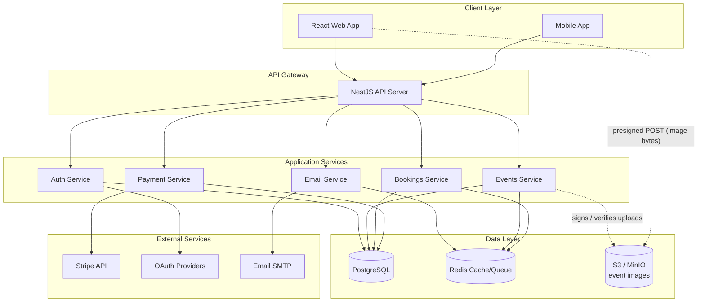

# Event Management Platform

> A production-grade, full-stack event management system built with React, NestJS, PostgreSQL, and Redis. Features real-time updates, secure authentication, payment processing, and comprehensive booking management.

[](https://www.typescriptlang.org/)
[](https://nestjs.com/)
[](https://nextjs.org/)
[](https://orpc.dev/)

## 📋 Table of Contents

- [Engineering Highlights](#engineering-highlights)
- [DX Highlights](#dx-highlights)
- [Key Features](#key-features)
- [Roadmap](#roadmap)
- [Architecture](#architecture)
- [Tech Stack](#tech-stack)
- [Getting Started](#getting-started)
- [Authentication & Authorization](#authentication--authorization)
- [Payment System](#payment-system)
- [Real-time Features](#real-time-features)
- [Deployment](#deployment)
- [Testing](#testing)

---

## 🛠 Engineering Highlights

### 1. Contract-First Architecture (E2E Type Safety)

To ensure 100% synchronization between the React frontend and NestJS backend, we utilize a shared workspace package (`@event-mgmt/contract`).

- **Single Source of Truth:** Zod schemas define the API boundary.
- **Zero Type Drift:** Build-time validation ensures that changing a field in the backend immediately triggers compilation errors in the frontend.
- **Reduced Integration Overhead:** Standardizes DTOs across the entire stack.

### 2. Seemless Opague Duo-token Cookies-only Authentication

- **Modern Security-first Auth** Prevent PID leaks, token forging/tempering.
- **Seemless Integration** Cookies race condition and background refresh lock (No UI/UX pitfall).
- **Argon2 as A New Default** Safer than bcrypt, hinders brute force attacks.
- **Cookies-only As NextJS Native** Ensures SEO & Server component compatability.

### 3. High-Concurrency Integrity (Race Condition Mitigation)

Ticketing systems face unique challenges during "hot" event drops. This platform implements:

- **Pessimistic Locking:** Uses PostgreSQL `SELECT FOR UPDATE` to lock seat availability rows during the transaction window, ensuring zero over-selling.
- **Distributed Locking:** Redis-based locks for coupon redemptions to prevent multiple users from exhausting a single-use code simultaneously.

### 3. Service Resilience & Observability

- **Circuit Breaker Pattern:** Protects the core API from cascading failures by monitoring Stripe and SMTP health; opens the circuit if external latency exceeds 5s.
- **Distributed Tracing:** Implements Correlation IDs propagated via NestJS Interceptors for unified logging across the request lifecycle.
- **Horizontal Scalability:** Stateless design optimized for Kubernetes HPA, utilizing Redis for shared session/queue state.

---

## 🚀 DX Highlights

### 1. Fullstack ESM & CJS Compatability

Solving NestJS persistent ESM compatability problem, esm-only packages work in NestJS!!.

### 2. No node-gyp Dependencies

Effortless deployment regardless of pipeline environment, no more bcrypt or node-gyp error.

### 3. Monorepo

Monorepo integration, where every changes, e2e tests, could be built with the full repo present.

### 4. Cutting Edge Contract-first Integration

The very first production-ready monorepo on the github with full Typescript NestJS 12, oRPC 2, Zod 4, NextJS 16, Redis 7, and BullMQ.

### 5. React Compiler

Follow the best practices to fully leverage React compiler integration, ease the overhead of useCallback and useMemo hooks.

### 6. Code Sanitary

Cleaner than Claude standard, every depreciation was studied and fixed.

---

## ✨ Key Features

### User Management & Authentication

- 🔐 **Opaque Duo Token Authentication** with access and refresh tokens
- 🌐 **OAuth 2.0 Integration** (Google, GitHub, Facebook)
- 👥 **Role-Based Access Control** (Admin, Organizer, Customer)
- ✉️ **Email Verification** and password reset flows
- 🔄 **Session Management** with device tracking

### Event Management

- 🎫 **Dynamic Pricing** and capacity management
- 📊 **Real-time Seat Availability** via WebSockets
- 🏷️ **Coupon System** with percentage and fixed discounts
- 🖼️ **Direct-to-S3 Cover Images** with in-browser crop & zoom (presigned POST, see [Event Images](#️-event-images))
- 🔒 **Race Condition Prevention** using distributed locks

### Booking & Ticketing

- 🎟️ **QR Code Generation** for each ticket
- 💳 **Payment Processing** (Stripe integration + mock mode)
- 📧 **Email Confirmations** with ticket details
- 🔍 **Ticket Validation** system for entry
- 📱 **Booking Management** (view, cancel, refund)

### Technical Features

- ⚡ **Real-time Updates** with WebSocket
- 🔀 **Circuit Breaker Pattern** for service resilience
- 📬 **Message Queue** (Bull + Redis) for async operations
- 🎯 **Correlation IDs** for distributed tracing
- 🏥 **Health Checks** for monitoring
- 🖼️ **Direct-to-S3 Uploads** via presigned POST (MinIO locally, S3 + CloudFront in AWS)
- 🐳 **Docker & Kubernetes**

---

## 🗺️ Roadmap

- [x] Complete application architecture & Design documentation
- [x] Complete application cloud architecture (AWS) & documentation
- [ ] [Partial] Update readme and docs
- [x] Zod 4 and oRPC contract pattern integration
- [x] Fullstack support CJS and ESM
- [x] Complete minimal k8s & terraform template
- [x] Ensure major workflows functionality (Auth & Event listing and creation & Booking)
- [ ] [Partial] Migrate NestJS and tests to the new oRPC error paradism
- [ ] [Partial] Edge cases handling
    - [x] Request thundering herd problems
    - [x] Coupon race condition
    - [X] Frontend cookies race condition
    - [x] Token corruption
    - [ ] ...
- [X] Ensure secondary workflows functionality
- [X] Flesh out API documentation with Scalar
- [x] finalize dependency-cruiser
- [ ] [Partial] Complete dockerization support
- [x] Direct-to-S3 event image upload (presigned POST) with in-browser crop & zoom
- [x] Better test coverage & Github Actions CI/CD & Bitbucket pipeline
    - [x] Major flow frontend tests
    - [x] Major flow backend tests
    - [x] Full suite e2e test (auth and booking)
    - [x] Github Actions CI/CD
    - [x] Bitbucket pipeline

---

## 🏗️ Architecture

### System Architecture



### Monorepo Structure

```
event-management-monorepo/
├── apps/
│   ├── backend/           # NestJS API
│   └── frontend/          # React SPA
├── packages/
│   ├── shared-schemas/    # Shared Zod schemas
│   └── contract/          # oRPC contract
├── terraform/             # AWS infrastructure (incl. event image bucket + CloudFront)
└── k8s/                   # Kubernetes manifests
```

---

## 🛠️ Tech Stack

### Frontend

- **NextJS 16** - UI library
- **Tanstack Query** - Query and state management
- **App Router** - Navigation
- **Shadcn & TailwindCSS** - Styling
- **Stripe Elements** - Payment UI
- **react-easy-crop** - Crop & zoom for event cover images
- **Socket.io Client** - Real-time updates

### Backend

- **NestJS 12** - Node.js framework
- **TypeORM** - ORM for PostgreSQL
- **PostgreSQL 15** - Primary database
- **Redis 7** - Caching & message queue
- **Bull** - Queue management
- **Stripe SDK** - Payment processing
- **AWS SDK v3** - S3 presigned POST for direct image uploads
- **Socket.io** - WebSocket server

### DevOps & Tools

- **Turborepo** - Monorepo management
- **Docker** - Containerization (MinIO as the local S3 stand-in)
- **Kubernetes** - Orchestration
- **GitHub Actions** - CI/CD
- **yarn 4** - Package manager
- **TypeScript** - Type safety
- **ESLint & Prettier** - Code quality

---

## 🚀 Getting Started

### Prerequisites

```bash
# Required
- Node.js 22+
- Docker & Docker Compose
- PostgreSQL 15
- Redis 7

# Optional (for production features)
- Stripe account
- AWS account (S3 + CloudFront) for event image uploads; locally MinIO is started by `docker compose`
- OAuth provider credentials
- SMTP server
```

### Quick Start (5 minutes)

#### 1. Clone the Repository

```bash
git clone https://github.com/yourusername/event-management.git
cd event-management
```

#### 2. Install Dependencies

```bash
npm install
```

#### 3. Configure Environment

```bash
# Backend
cp apps/backend/.env.example apps/backend/.env

# Frontend
cp apps/frontend/.env.example apps/frontend/.env
```

**Minimum required configuration** (apps/backend/.env):

```env
# Database
DB_HOST=localhost
DB_PORT=5432
DB_USERNAME=postgres
DB_PASSWORD=postgres
DB_NAME=event_management

# Redis
REDIS_HOST=localhost
REDIS_PORT=6379

# JWT Secrets (use strong random strings in production)
JWT_ACCESS_SECRET=your-super-secret-access-key
JWT_REFRESH_SECRET=your-super-secret-refresh-key

# Feature Flags (mock mode - no external services needed)
FEATURE_PAYMENT_ENABLED=false
FEATURE_EMAIL_ENABLED=false
```

**Optional: event image uploads.** Skipped by default (the upload endpoint answers 503). To try it locally,
`docker compose up -d` already starts MinIO and creates the bucket; then add to `apps/backend/.env`:

```env
S3_BUCKET=eventeer-images
S3_REGION=us-east-1
S3_ENDPOINT=http://localhost:9000
S3_FORCE_PATH_STYLE=true
S3_PUBLIC_BASE_URL=http://localhost:9000/eventeer-images
AWS_ACCESS_KEY_ID=minioadmin        # MinIO's local root credentials, not AWS keys
AWS_SECRET_ACCESS_KEY=minioadmin
```

See [Event Images](#️-event-images) for how it works and the AWS settings.

#### 4. Start Development Servers

```bash
npm run dev
```

#### 5. Access the Application

- **Frontend:** http://localhost:3000
- **Backend API:** http://localhost:4000

### Seed Demo Data (Optional)

```bash
npm run seed:demo
```

This creates:

- Admin user: `admin@demo.com` / `Admin123!`
- Organizer user: `organizer@demo.com` / `Organizer123!`
- Customer user: `customer@demo.com` / `Customer123!`
- Sample events

---

### Core Endpoints

#### Authentication

```http
POST   /auth/register              # Register new user
POST   /auth/login                 # Login with credentials
POST   /auth/logout                # Logout current session
POST   /auth/refresh               # Refresh access token
GET    /auth/me                    # Get current user
POST   /auth/verify-email          # Verify email address
POST   /auth/forgot-password       # Request password reset
POST   /auth/reset-password        # Reset password

# OAuth
GET    /auth/oauth/google          # Google OAuth flow
GET    /auth/oauth/github          # GitHub OAuth flow
GET    /auth/oauth/facebook        # Facebook OAuth flow
```

#### Events

```http
GET    /events                     # List all events (public)
GET    /events/:id                 # Get event details (public)
POST   /events                     # Create event (ORGANIZER/ADMIN)
POST   /events/image-upload        # Get a presigned S3 POST for a cover image (ORGANIZER/ADMIN)
PUT    /events/:id                 # Update event (owner/ADMIN)
DELETE /events/:id                 # Delete event (owner/ADMIN)
GET    /events/my/events           # Get user's events (ORGANIZER)
```

#### Bookings

```http
POST   /bookings                   # Create booking (authenticated)
GET    /bookings/:id               # Get booking (owner/ADMIN)
POST   /bookings/:id/confirm       # Confirm booking payment
DELETE /bookings/:id               # Cancel booking
GET    /bookings/my/bookings       # Get user's bookings
GET    /bookings/event/:id/bookings # Get event bookings (ORGANIZER)
GET    /bookings/admin/all         # Get all bookings (ADMIN)
```

#### Coupons

```http
POST   /coupons                    # Create coupon (ORGANIZER/ADMIN)
GET    /coupons/:code              # Get coupon details
```

#### Tickets

```http
POST   /tickets/validate           # Validate ticket QR code
GET    /tickets/lookup             # Lookup ticket by QR
```

---

## 💳 Payment System

### Dual Payment Mode

The platform supports both **real Stripe payments** and **mock payments**:

#### Mock Payment Mode (Default)

- Perfect for demos and portfolios
- No Stripe account required
- Auto-succeeds after 2 seconds
- Full booking flow works
- Clear "Demo Mode" indicators

**Configuration:**

```env
FEATURE_PAYMENT_ENABLED=true
# Don't set STRIPE_SECRET_KEY
```

#### Real Stripe Mode

- Production-ready payments
- Actual credit card processing
- Webhook support

**Configuration:**

```env
FEATURE_PAYMENT_ENABLED=true
STRIPE_SECRET_KEY=sk_live_...
STRIPE_WEBHOOK_SECRET=whsec_...
```

### Coupon System

**Discount Types:**

- **Percentage:** 10%, 20%, 50% off
- **Fixed Amount:** $10, $25, $50 off

**Features:**

- Usage limits (max redemptions)
- Expiration dates
- Minimum purchase amounts
- Race condition prevention via distributed locks

---

## 🖼️ Event Images

Cover images go **straight from the browser to S3**; the API only signs the upload, so image bytes never pass through it.

```
1. Browser: pick a file, crop/zoom it (react-easy-crop), re-encode to WebP/JPEG on a canvas (21:9, max 1680px)
2. POST /events/image-upload { contentType, size }  ->  presigned POST { url, fields, key }
3. Browser POSTs the file to S3 using those fields      (S3 enforces type + size from the signed policy)
4. POST /events { ..., imageUploadKey: key }            (or PUT /events/:id)
5. API verifies the upload (HEAD, magic bytes), copies tmp/ -> events/, stores the public URL as imageUrl
```

- **Presigned POST, not PUT:** a POST policy lets S3 itself reject bodies outside `[1, size]` bytes or with another `Content-Type`.
- **Per-user keys:** uploads land in `tmp/events/<userId>/<uuid>.<ext>`; only that user can attach them. A bucket lifecycle rule expires `tmp/` after a day, so abandoned uploads clean themselves up.
- **Verified before publishing:** the object's real type is sniffed from its magic bytes (the `Content-Type` is client-supplied), then copied server-side to `events/<uuid>.<ext>`. Replacing or clearing an image, or deleting the event, removes the old object.
- **Served from CloudFront** (origin access control; only `events/*` is readable) with `nosniff` and a locked-down CSP.
- `imageUrl` (an external link) still works for API clients and seed data; an event takes either `imageUrl` or `imageUploadKey`, not both.

**Local development** needs no AWS account: `docker compose up -d` starts MinIO and creates the bucket. Uncomment the `S3_*` / `AWS_*` block in `apps/backend/.env`
(the `--profile app` stack is already wired). **Configuration** (all in `apps/backend/.env.example`): `S3_BUCKET`, `S3_REGION`, `S3_PUBLIC_BASE_URL`
(all three or none), plus `S3_ENDPOINT` / `S3_PUBLIC_ENDPOINT` / `S3_FORCE_PATH_STYLE` for S3-compatible stores. With `S3_BUCKET` unset the feature is off and the endpoint answers 503.
AWS credentials are never configured in the app: the SDK's default chain supplies them (ECS task role, EKS IRSA, or `AWS_ACCESS_KEY_ID` locally).

**AWS:** `terraform/main.tf` provisions the bucket, CORS (set `image_upload_allowed_origins` to your web origin), lifecycle rule, CloudFront and IAM policy.
Kubernetes: set `s3-*` in `k8s/configmap.yaml` and the role ARN in `k8s/serviceaccount.yaml`.

---

## ⚡ Real-time Features

### WebSocket Integration

### Real-time Updates

- **Seat Availability:** Instant updates when bookings are made
- **Event Changes:** Organizers see changes immediately
- **Booking Status:** Payment confirmations in real-time

---

## 🚢 Deployment

### Docker Deployment

#### Build Images

```bash
# Backend
docker build -f apps/backend/Dockerfile -t event-mgmt-backend:latest .

# Frontend
docker build -f apps/frontend/Dockerfile -t event-mgmt-frontend:latest .
```

#### Run with Docker Compose

```bash
docker-compose up -d
```

The stack includes **MinIO** (S3 API on `:9000`, console on `:9001`) and a one-shot `minio-init` job that creates the
image bucket, serves `events/*` publicly and expires `tmp/` after a day. The `app` profile already wires the backend to it.

### Kubernetes Deployment

#### Prerequisites

- Kubernetes cluster (minikube, EKS, GKE, AKS)
- kubectl configured
- nginx-ingress-controller

#### Deploy

```bash
# Create namespace
kubectl create namespace event-management

# Create secrets
kubectl create secret generic postgres-secret \
  --from-literal=username=postgres \
  --from-literal=password=<strong-password> \
  -n event-management

kubectl create secret generic stripe-secret \
  --from-literal=secret-key=<stripe-key> \
  --from-literal=webhook-secret=<webhook-secret> \
  -n event-management

# Image uploads: set s3-bucket / s3-region / s3-public-base-url in k8s/configmap.yaml and the
# IAM role ARN in k8s/serviceaccount.yaml (EKS IRSA). Without IRSA, create the optional secret instead:
kubectl create secret generic aws-s3-secret \
  --from-literal=access-key-id=<key-id> \
  --from-literal=secret-access-key=<secret> \
  -n event-management

# Apply manifests
kubectl apply -f k8s/

# Verify deployment
kubectl get pods -n event-management
kubectl get services -n event-management
kubectl get ingress -n event-management
```

#### Scale

```bash
# Manual scaling
kubectl scale deployment backend --replicas=5 -n event-management

# Auto-scaling (HPA already configured)
kubectl get hpa -n event-management
```

---

## 🧪 Testing

### Running Tests

```bash
# All tests
yarn test

# Backend unit tests
cd apps/backend && yarn test

# Backend e2e tests
cd apps/backend && yarn test:e2e

# Frontend tests
cd apps/frontend && yarn test

# With coverage
yarn test:e2e
```

### Testing Strategy

**Unit Tests:**

- Services: Business logic validation
- Guards: Authorization checks
- Utilities: Helper functions

**Integration Tests:**

- Image uploads: real presigned-POST signing and policy checks; the e2e suite swaps only the S3 calls for an in-memory bucket, so no AWS (or MinIO) is needed
- API endpoints: Request/response validation
- Database interactions: CRUD operations
- Authentication flows: Login, registration
